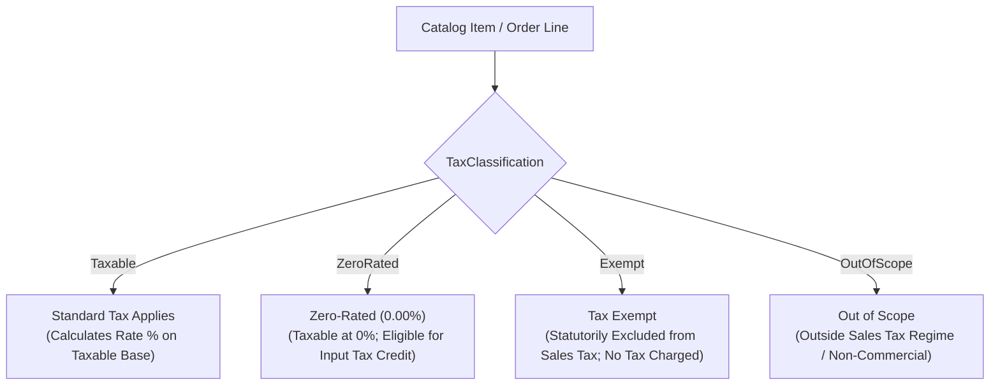

# CBOS Tax Profiles & Statutory Classification Guide

| Attribute | Details |
| :--- | :--- |
| **Area** | Catalog / Fiscal Tax Profiles & Pricing Architecture |
| **Audience** | Shop Owners, Store Accountants, Financial Controllers, Administrators |
| **Target Baseline** | CBOS 1.2.2 Baseline / CBOS 1.3.0 Candidate |
| **Status** | **SOURCE-VERIFIED STANDARD** |
| **Classification** | **PUBLIC-SAFE** |

---

## 1. Statutory Tax Framework & Disclaimer

> [!IMPORTANT]
> **SYNTHETIC RATES & STATUTORY DISCLAIMER:**
> All tax rates, percentages, provincial jurisdictions, and authority names mentioned throughout this document and application test suites (such as 16%, 18%, or 5%) are **strictly synthetic examples** provided solely for functional demonstration and software configuration testing.
>
> Clovent Business Operating System (CBOS) does not provide legal, accounting, or statutory tax advice. Business owners and retail operators are strictly responsible for consulting certified tax advisors and applicable statutory revenue bodies to determine their legal tax registration, applicable rates, and compliance obligations.

CBOS models fiscal sales tax through the `TaxProfile` domain aggregate in the Catalog bounded context (`src/Clovent.Catalog/TaxProfiles/TaxProfile.cs`). This architecture supports provincial and federal tax segregation, goods versus services classification, inclusive and exclusive pricing, and immutable sale-time tax snapshots.

---

## 2. Core Structure of a Tax Profile

Each tax regime is configured as an independent `TaxProfile` record with the following source-defined properties:

| Property | Description | Example (Synthetic) |
| :--- | :--- | :--- |
| **`Code`** | Unique statutory code identifying the profile. | `PK-PRA-SRV-16` |
| **`InvoiceDisplayName`** | Human-readable name printed on customer bills and receipts. | `Punjab Sales Tax (Services)` |
| **`Authority`** | Revenue authority governing the tax. | `PRA`, `SRB`, `KPRA`, `BRA`, `FBR` |
| **`Jurisdiction`** | Provincial or federal geographic jurisdiction. | `Punjab`, `Sindh`, `Federal` |
| **`TaxClassification`** | Statutory taxability classification (see Section 3). | `Taxable` |
| **`ItemClassification`** | Constitutional goods vs. services classification (see Section 4). | `Services` |
| **`RatePercentage`** | The applicable tax rate percentage. | `16.00` (for 16%) |
| **`PricingMode`** | How tax interacts with catalog prices (see Section 5). | `Inclusive` or `Exclusive` |
| **`EffectiveFromUtc`** | Timestamp when this tax rate legally takes effect. | `2026-07-01 00:00:00Z` |
| **`EffectiveToUtc`** | Optional timestamp when the rate expires or is superseded. | `null` (active indefinitely) |
| **`PaymentMethodRestriction`** | Optional tender restriction (e.g. concessional card rate). | `DigitalPaymentOnly` or `null` |

---

## 3. Statutory Taxability Classifications (`TaxClassification`)

Under `Clovent.Catalog.TaxProfiles.TaxClassification`, items are categorized into four distinct taxability states:

1. **`Taxable`:**
   Standard taxable transactions. The configured `RatePercentage` is calculated on the line subtotal and recorded as tax liability.
2. **`ZeroRated`:**
   Goods or services taxed at an explicit rate of $0.00\%$. The tax calculation produces $0.00$ tax, but transaction values are reported as zero-rated taxable turnover in fiscal audit summaries.
3. **`Exempt`:**
   Goods or services legally exempt from sales tax under statutory schedules (e.g. unprocessed basic foodstuffs). No tax is computed, and the receipt indicates the item is exempt.
4. **`OutOfScope`:**
   Transactions not subject to the sales tax regime (e.g., deposits, gift voucher purchases, or non-commercial adjustments).

---

## 4. Item Classification: Goods vs. Services (`ItemTaxClassification`)

Under constitutional tax separation (e.g. Pakistan's 18th Constitutional Amendment), sales tax on goods is governed federally by the Federal Board of Revenue (FBR), whereas sales tax on services is governed by provincial revenue authorities (PRA, SRB, KPRA, BRA):

- **`Goods`:** Tangible retail goods, merchandise, packaged retail beverages, and physical inventory products.
- **`Services`:** Restaurant dining, catering, takeaway preparation, delivery fees, and hospitality services.

Assigning the proper `ItemClassification` ensures that financial outbox exports to external accounting software (e.g. QuickBooks) map taxes to the correct ledger accounts.

---

## 5. Pricing Modes: Tax Inclusive vs. Tax Exclusive (`TaxPricingMode`)

CBOS supports both commercial pricing models:

### 5.1 Tax Inclusive Pricing (`TaxPricingMode.Inclusive`)
In hospitality and retail, menu prices often represent the total price paid by the customer. The tax is already embedded inside the retail price.

- **Formula:**
  $$\text{Taxable Base Amount} = \text{Round}\left(\frac{\text{Gross Shelf Price}}{1 + \frac{\text{RatePercentage}}{100}}\right)$$
  $$\text{Tax Amount} = \text{Gross Shelf Price} - \text{Taxable Base Amount}$$

- **Synthetic Example (16% Inclusive on \$116.00 Item):**
  $$\text{Taxable Base} = \frac{116.00}{1.16} = 100.00$$
  $$\text{Tax Amount} = 116.00 - 100.00 = 16.00$$
  *Customer pays exactly \$116.00. The receipt prints the gross price and displays a breakdown note: "Includes \$16.00 Tax".*

### 5.2 Tax Exclusive Pricing (`TaxPricingMode.Exclusive`)
In wholesale or corporate sales, prices exclude tax; sales tax is added on top of the bill total at checkout.

- **Formula:**
  $$\text{Taxable Base Amount} = \text{Net Shelf Price}$$
  $$\text{Tax Amount} = \text{Round}\left(\text{Net Shelf Price} \times \frac{\text{RatePercentage}}{100}\right)$$
  $$\text{Grand Total} = \text{Net Shelf Price} + \text{Tax Amount}$$

- **Synthetic Example (16% Exclusive on \$100.00 Item):**
  $$\text{Tax Amount} = 100.00 \times 0.16 = 16.00$$
  $$\text{Grand Total} = 100.00 + 16.00 = 116.00$$
  *Customer pays \$116.00 at settlement.*

---

## 6. Assigning Tax Profiles to Catalog Categories & Products

To maintain manageable catalog administration:

1. **Category Inheritance:**
   Assign a default `TaxProfile` to a product category (e.g. *Hot Beverages* -> `PK-PRA-SRV-16`). All products created within this category automatically inherit the category's tax profile.
2. **Product Override:**
   If a specific product within a category has a distinct tax classification (e.g. an exempt bottled water brand in a taxable beverage category), assign the specific `TaxProfile` directly on the Product definition. The product-level assignment overrides category inheritance.

---

## 7. Sale-Time Tax Snapshots & Ledger Immutability

In strict adherence to the **Financial Immutability Invariant** (`AGENTS.md` Invariant 2):

1. **Sale-Time Snapshot:**
   When an order is settled, CBOS captures a permanent `ReceiptSnapshot` recording:
   - Applied tax profile ID and statutory code.
   - Exact percentage rate at the moment of sale.
   - Taxable base amount and computed tax amount.
   - Pricing mode (`Inclusive` vs `Exclusive`).
2. **Protection Against Retroactive Changes:**
   If a store owner updates a tax rate in the catalog (e.g. rate changes on July 1st), **historical completed orders are never retroactively recalculated**. Past sales reports, tax returns, and customer reprints reflect the immutable facts captured at the moment the sale took place.
3. **Rounding Invariant:**
   All line-level tax computations strictly execute `MidpointRounding.AwayFromZero` to ensure mathematical reconciliation between order lines and ledger postings.
