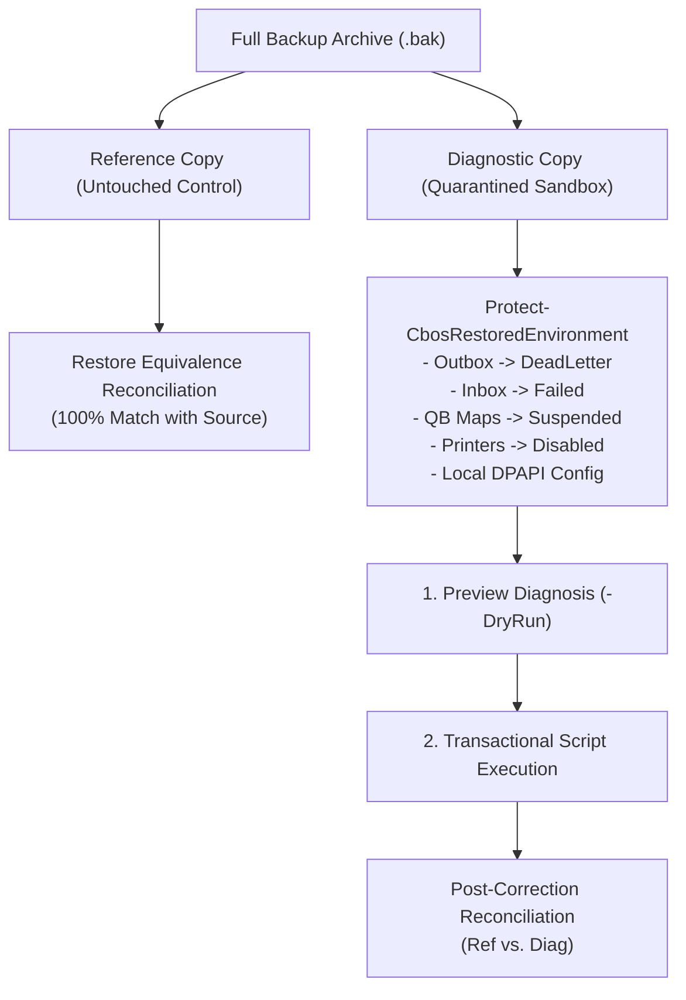

# Support Runbook: Customer Database Support & Safe Corrective Workflow

| Attribute | Details |
| :--- | :--- |
| **Area** | Customer Database Support, Field Engineering, Disaster Recovery, Financial Governance |
| **Audience** | Level 2–3 Support Engineers, Database Administrators, Systems Engineers, Engineering Leadership |
| **Last Reviewed Version** | CBOS 1.2.2 / 1.2.3 |
| **Status** | **PROCEDURAL RUNBOOK & STANDARD** |
| **Classification** | **PUBLIC-SAFE** |

---

## 1. Overview & Operational Principles

This runbook establishes the formal, audited procedure for customer database diagnostics, support bundling, isolated restoration, and reviewed corrective-script execution across Clovent Business Operating System (CBOS).

### Core Principles
1. **Separation of Support Privileges:** Frontline cashier and POS application accounts (`cbos_cashier`, `CBOS_POS_Users`, `BUILTIN\Users`) operate under strict least-privilege rights (`db_datareader`, `db_datawriter`, execute, view definition) and **cannot** perform database backups, restores, or administrative maintenance. Support operations require authorized support staff credentials (`db_backupoperator`, `db_owner`, or `sysadmin`).
2. **Zero Credential Leakage:** Plaintext passwords must never appear in logs, configuration files, console transcripts, or command-line parameters. Masking, SecureString handling, and DPAPI encryption protect credentials at all stages.
3. **Mandatory Customer Authorization:** Customer database archives contain proprietary business records and live customer data. Diagnostic bundles may only be generated with explicit, recorded customer authorization (`-CustomerConsent`) and transferred via secure, customer-authorized channels. Automated or background cloud uploads are strictly prohibited.
4. **Two-Copy Isolation (Reference vs. Diagnostic):** Support restorations must **never** target or overwrite an existing production database by default. Restores are performed into two separate copies: an untouched **Reference** copy (for baseline equivalence) and a quarantined **Diagnostic** copy with external integrations, outbox synchronization, scheduled jobs, and printing disabled.
5. **Strict Financial Transaction Immutability (PDR-0003):** Completed orders, payments, refunds, tax snapshots, and customer ledger historical records are **strictly immutable**. Support scripts are prohibited from rewriting or deleting completed financial transactions. Financial discrepancies must be resolved exclusively via approved compensating transactions.

---

## 2. Authorized Database Backup Procedure

Authorized support staff can create a consistent full database backup of the entire CBOS database, including all six bounded-context schemas (`[Authentication]`, `[Identity]`, `[MasterData]`, `[Catalog]`, `[Inventory]`, `[Restaurant]`).

### 2.1 Authentication & Privilege Separation (Backup vs. Restore Roles)
- **Privilege Separation Principle:**
  - **Database Backup Rights (`db_backupoperator` / `db_owner`):** Authorized staff holding `db_backupoperator` on the target database can create backups via `BACKUP DATABASE ... WITH COPY_ONLY, CHECKSUM`. However, `db_backupoperator` **strictly lacks restore permissions** (it cannot restore databases or execute `RESTORE VERIFYONLY` against `master`).
  - **Database Restoration Rights (`sysadmin` / `dbcreator`):** Restoring a database (allocating or recreating physical files) strictly requires the SQL Server server role `sysadmin` or `dbcreator`.
  - **Frontline Cashier Restriction:** Application/cashier accounts (`cbos_cashier`, `CBOS_POS_Users`) hold only `db_datareader`/`db_datawriter` and are unconditionally denied backup and restore execution.
  - **Least Privilege Proven without Sysadmin:** Administrative tests must never confuse a `sysadmin` connection with a least-privilege proof. Least privilege for backup is proven exclusively via `db_backupoperator` without `sysadmin`.
- **Zero Credential Leakage:** Passwords must be provided as secure strings via `Read-Host -AsSecureString` or `Get-Credential`. Plaintext passwords are automatically masked in console transcripts, connection strings, and error messages.

### 2.2 Backup Command
Execute the support backup script:

```powershell
# Using Windows Authentication (Integrated):
.\scripts\support\Backup-CbosDatabase.ps1 `
    -Server "localhost" `
    -Database "Clovent_BusinessOperatingSystem" `
    -UseWindowsAuth

# Or using SQL Server Authentication with Secure Interactive Prompting:
$sqlUser = "cbos_backupop"
$sqlPassword = Read-Host -Prompt "Enter password for $sqlUser" -AsSecureString
.\scripts\support\Backup-CbosDatabase.ps1 `
    -Server "localhost" `
    -Database "Clovent_BusinessOperatingSystem" `
    -SqlUser $sqlUser `
    -SqlPassword $sqlPassword
```

### 2.3 Technical Guarantees
- Executes `BACKUP DATABASE [<Database>] TO DISK = @path WITH COPY_ONLY, CHECKSUM, STATS = 10, INIT`. The `COPY_ONLY` clause ensures the customer's production log sequence number (LSN) chain is preserved.
- When executed by an operator possessing restore privileges (`sysadmin`/`dbcreator`), verifies physical archive media integrity immediately using `RESTORE VERIFYONLY FROM DISK = @path WITH CHECKSUM`. When run under least-privilege `db_backupoperator`, media verification is safely skipped to enforce privilege boundaries.
- Computes SHA-256 cryptographic digest of the generated `.bak` file.

---

## 3. Support Bundle Packaging, Manifest Integrity & Data Privacy

When an issue requires offline escalation or developer investigation, produce a self-contained support bundle.

### 3.1 Customer Consent Requirement
Customer consent is an unconditional prerequisite. The technician must obtain explicit agreement from the customer and specify `-CustomerConsent`, the customer organization name, and the authorized contact.

```powershell
.\scripts\support\New-CbosSupportBundle.ps1 `
    -Server "localhost" `
    -Database "Clovent_BusinessOperatingSystem" `
    -UseWindowsAuth `
    -TicketId "INC-20261017-001" `
    -CustomerOrganization "Grandview Hospitality LLC" `
    -AuthorizedBy "Jane Doe (General Manager)" `
    -CustomerConsent
```

### 3.2 Manifest Integrity vs. Authentication
> [!IMPORTANT]
> **SHA-256 MANIFEST LIMITATION:**
> The SHA-256 digest in `manifest.json` provides **data integrity checking** (detecting file corruption, incomplete transfers, or bit rot). It does **NOT** provide **cryptographic authentication, origin non-repudiation, or provenance** unless accompanied by an asymmetric digital signature (e.g. GPG or X.509 code-signing certificate) or transferred over an independently trusted, authenticated channel.

### 3.3 Customer Data Sensitivity & Anonymization Reality
> [!WARNING]
> **DATABASE BACKUPS ARE NOT ANONYMIZED:**
> While application logs inside `redacted_logs/` have PANs, passwords, and tokens stripped, the `.bak` database archive inside the bundle is a **full, unanonymized snapshot of the customer's database**. It contains real customer names, mobile numbers, addresses, account receivables, and transaction histories.
> 
> Technical and organizational safeguards:
> 1. Bundles must be transferred exclusively via customer-authorized, end-to-end encrypted protocols (TLS 1.3 / SFTP).
> 2. Bundles must be stored on BitLocker/LUKS encrypted storage with least-privilege RBAC.
> 3. Bundles must be deleted upon ticket resolution in accordance with customer data retention policies.
> 4. **Automated or unapproved cloud uploads are strictly prohibited.**

### 3.4 Tested Software Controls vs. Operator / Organizational Requirements

To preserve audit integrity, programmatically enforced software controls are strictly distinguished from operator requirements and organizational policies:

| Category | Control / Requirement | Enforcement Mechanism | Failure Consequence |
| :--- | :--- | :--- | :--- |
| **Tested Software Control** | SHA-256 Digest Verification | `Restore-CbosIsolatedDatabase.ps1` | `CHECKSUM MISMATCH`: Restoration aborts before SQL connection. |
| **Tested Software Control** | Backup Media & Chain Integrity | `COPY_ONLY, CHECKSUM` | Preserves production LSN; detects corrupt media. |
| **Tested Software Control** | Least-Privilege Gate | `Test-CbosSupportPrivileges` | `SECURITY VIOLATION`: Cashiers blocked; credentials masked. |
| **Tested Software Control** | External Dispatch Quarantine | `Protect-CbosRestoredEnvironment` | Outbox -> `DeadLetter`; SyncMaps -> `Suspended`. |
| **Tested Software Control** | Printer Hardware Isolation | Quarantined `printers.json` | `PrinterRouter` returns `NoAssignment`; zero physical spooling. |
| **Tested Software Control** | Script Catalog Whitelisting | `approved_scripts_catalog.json` | `UNAPPROVED SCRIPT BLOCKED` unless `-AllowUnapprovedScript`. |
| **Tested Software Control** | Tamper Content Hash Check | SHA-256 comparison vs catalog | `SCRIPT INTEGRITY VIOLATION`: Modified script rejected. |
| **Tested Software Control** | Target Database Regex Guard | `-- TARGET_DATABASE_PATTERN` | `TARGET DATABASE GUARD VIOLATION`: Cross-database run blocked. |
| **Tested Software Control** | Target Customer ID Pinning | `-- TARGET_CUSTOMER_ID` | `EXPLICIT CUSTOMER ID REQUIRED`: Protects un-scoped Customer schema. |
| **Tested Software Control** | Atomic Transaction Rollback | SQL Transaction + Postcheck | `POSTCHECK FAILED`: Zero mutation; failure logged to audit. |
| **Tested Software Control** | Concurrent Duplicate Protection | `sp_getapplock` + Filtered UX | `REPEAT EXECUTION BLOCKED`: Exactly 1 commit; 0 duplicate ledger rows. |
| **Tested Software Control** | Schema Upgrade Idempotency | EF Core `IF NOT EXISTS` DDL | Upgrade succeeds without table conflict on existing audit schemas. |
| **Operator / Policy Requirement** | Secure Bundle Transfer | SFTP / TLS 1.3 encrypted transfer | Organizational mandate: Never transmit unencrypted over open network. |
| **Operator / Policy Requirement** | Storage at Rest Encryption | BitLocker / LUKS full-disk encryption | Organizational mandate: Support bundles stored on encrypted volumes. |
| **Operator / Policy Requirement** | Mandatory Customer Consent | Written customer agreement | Operator gate: `-CustomerConsent` flag required with contact name. |
| **Operator / Policy Requirement** | Secure Credential Entry | Interactive password prompt | Operator standard: `Read-Host -AsSecureString` / `Get-Credential`. |
| **Operator / Policy Requirement** | Post-Incident Bundle Deletion | Retention policy enforcement | Organizational mandate: Securely wipe diagnostic bundles post-ticket. |

---

## 4. Isolated Restoration & Two-Copy Isolation Architecture

Restoring a customer database into a development or test environment must never interfere with operational databases or trigger unintentional side-effects.

### 4.1 Two-Copy Isolation Standard
When investigating customer database issues, restore **two independent copies**:
1. **Untouched Reference Copy (`CBOS_Support_Ref_<TicketId>_Isolated`):**
   - Restored directly from backup.
   - Preserved 100% untouched without any quarantine or script modifications.
   - Acts as the baseline control for **Restore Equivalence Reconciliation** (verifying restore fidelity against source).
2. **Sanitized Diagnostic Copy (`CBOS_Support_Diag_<TicketId>_Isolated`):**
   - Restored directly from backup.
   - Sanitized via `Protect-CbosRestoredEnvironment` prior to starting CBOS or executing corrective scripts.
   - Acts as the safe sandbox for diagnosis and tested corrections.



### 4.2 Automated Environment Sanitization (`Protect-CbosRestoredEnvironment`)
Before launching CBOS or testing against the Diagnostic copy, external integrations are quarantined:
1. **Transactional Outbox Quarantine:** Sets all `Pending`, `Processing`, and `RetryScheduled` records in `[Restaurant].[OutboxMessages]` to `DeadLetter` with failure reason `Quarantined in isolated support environment`. Proves restored copy cannot dispatch external webhook/HTTP calls.
2. **Sync Inbox Quarantine:** Sets `[Restaurant].[SyncInboxRecords]` in `Received`/`Pending` status to `Failed`.
3. **QuickBooks Sync Suspension:** Sets `[Restaurant].[QuickBooksSyncMaps]` to `Suspended`.
4. **Physical Printing Neutralization:** Generates a quarantined `printers.json` with all printer profiles disabled or cleared. Restored database cannot spool physical print jobs to kitchen or counter receipt printers.
5. **Machine-Bound DPAPI Reconfiguration:** Customer DPAPI connection strings cannot be decrypted across machines. Generates a local `database.config.json` targeting the isolated database.

---

## 5. Corrective-Script Security & Execution Governance

### 5.1 Beyond Static Pattern Matching
Static SQL regex filtering (such as blocking `UPDATE [Restaurant].[Orders]`) is a useful linting guard, but **is not a complete security boundary**. Sophisticated or accidental mutations (dynamic SQL, aliases, trigger circumvention, multi-table joins) bypass regex easily.

CBOS enforces a multi-layered security model:
1. **Script Catalog Whitelist:** Every approved script is registered in `scripts/support/approved_scripts_catalog.json` with its canonical SHA-256 digest. Unapproved or altered scripts are strictly rejected unless explicitly bypassed with `-AllowUnapprovedScript` in isolated test environments.
2. **Target Database Pattern Guard:** Header `-- TARGET_DATABASE_PATTERN:` restricts script execution to matching database name patterns (e.g. `(?i)^CBOS_Support_Diag_.*_Disposable$`). Scripts scoped to diagnostic copies cannot run against production or reference copies.
3. **Target Schema Guard:** Header `-- TARGET_SCHEMA:` verifies the required schema exists before execution.
4. **Scoped Administrative Permissions:** The executing connection must possess `db_owner` or `sysadmin` privileges. Unprivileged or cashier accounts are rejected.
5. **Precheck Assertion Gate:** Precheck queries must evaluate successfully (returning `1`, positive count, or text starting with `'PASS'`). If the precheck returns `0`, `FAIL`, or null, **execution halts immediately before opening a transaction or creating pre-fix backups**. Zero mutation occurs.
6. **Atomic Transactional Rollback:** The mutation is wrapped in a SQL transaction. If any SQL error occurs or postcheck reconciliation fails, the transaction is completely rolled back (`ROLLBACK TRANSACTION`).
7. **Concurrency-Safe Repeat Protection:** Uses a database-level filtered unique index:
   ```sql
   CREATE UNIQUE INDEX [UX_SupportScriptExecutionAudit_ScriptId_Success]
   ON [MasterData].[SupportScriptExecutionAudit] ([ScriptId])
   WHERE [Outcome] = 'Success';
   ```
   Queries use `WITH (UPDLOCK, HOLDLOCK)` to prevent concurrent execution races across multiple support operators.

---

## 6. Domain Rules for Compensating Customer Ledger Entries (PDR-0003)

### 6.1 Why Arbitrary Ledger INSERTs Are Unsafe
In CBOS receivables accounting, a customer ledger entry is not an arbitrary log entry. It governs financial balances and legal auditability:
- **Balance Invariant:** In the `Restaurant` bounded context, `Customer.OutstandingBalance` is a cached aggregate projection that **must strictly equal** `SUM(Debit) - SUM(Credit)` across all its `CustomerLedgerEntries`. If a support script inserts a ledger row without updating `Customer.OutstandingBalance` (or vice-versa), the receivables ledger drifts out of balance, corrupting aging reports.
- **Running Balance Continuity:** Each entry records `RunningBalance`, which must equal `PreviousRunningBalance + Debit - Credit`.
- **Accounting Immutability:** Historical sales invoices (`ORD-...`) and payments (`PAY-...`) cannot be edited to resolve a dispute. Under PDR-0003, corrections must be made via **additive compensating credit memos**.
- **Authorization & Audit Linkage:** Every compensating transaction must reference a formal authorization code (`-CompensationReference`, e.g. `AUTH-DISPUTE-CR-20261017-001`).

### 6.2 Billing Dispute Walkthrough: 1,044.00 PKR → 944.00 PKR
In our verified billing dispute scenario:
1. **Initial State:** Customer `CREDIT-DEMO` had an outstanding balance of **1,044.00 PKR** resulting from Dine-In Order #3 (2x Biryani on credit account).
2. **Approved Concession:** Following customer dispute review, store management approved a **100.00 PKR** goodwill credit concession.
3. **Compensating Correction (`FIX_20261017_02_CompensatingLedgerAdjustment.sql`):**
   - Does NOT edit Order #3 or its payment record.
   - Inserts an additive `CustomerLedgerEntry` with:
     - `Debit`: `0.00`
     - `Credit`: `100.00`
     - `RunningBalance`: `944.00`
     - `Reference`: `'COMP-DISPUTE-20261017'`
     - `Description`: `'Approved support compensation credit note for dispute resolution (PDR-0003 compliant)'`
     - `PaymentMethod`: `'Support Credit Memo'`
   - Updates `Customer.OutstandingBalance = 944.00` and `UpdatedAtUtc = SYSUTCDATETIME()`.
4. **Post-Correction Invariant:**
   - `OutstandingBalance` (`944.00`) = `SUM(Debit)` (`1044.00`) - `SUM(Credit)` (`100.00`) = `944.00 PKR`.
   - Completed order count, cash payments (`1,644.00 PKR`), historical tax snapshots (`144.00 PKR`), and receipt snapshots remain **100% identical and unchanged**.

### 6.3 Separation of Equivalence vs. Post-Correction Reconciliation
- **Restore Equivalence (`--reconcile-equivalence`):** Compares **Source Database vs. Restored Reference Database**. Proves the backup and restore process produced an exact 100% bitwise/domain duplicate (including the original 1,044.00 PKR balance).
- **Post-Correction Reconciliation (`--reconcile-post-correction`):** Compares **Reference Database vs. Diagnostic Database**. Proves that ONLY the targeted customer balance changed (1,044.00 -> 944.00 PKR), while all orders, payments, taxes, and frozen receipts remained 100% immutable.

### 6.4 Retained Architectural Limitation: Un-Scoped Customer Ownership & Isolation Prerequisite
> [!WARNING]
> **RETAINED ARCHITECTURAL LIMITATION & DEPLOYMENT PREREQUISITE (PDR-0003 & TENANCY):**
> In the current CBOS implementation, `[Restaurant].[Customers]` and `[Restaurant].[CustomerLedgerEntries]` **do not possess a `CompanyId`, `TenantId`, or `BranchId` column** (confirmed in `Customer.cs`, `CustomerConfiguration.cs`, and `RestaurantPersistenceInitializer.cs`).
> 
> **Database-Per-Customer/Store Isolation is a Deployment Prerequisite:**
> Customer and store tenant isolation is **not enforced within the relational schema**. Database names (e.g. `CBOS_Store123`) and customer GUIDs alone **do not provide cryptographic or schema-enforced proof of tenant ownership**.
> 
> Physical database separation (one database per store/restaurant instance) must be **independently established and enforced as a mandatory deployment prerequisite** at the infrastructure layer (e.g. dedicated SQL Server instances or discrete catalog databases with isolated host credentials, firewall perimeters, and store connection string bindings).
> 
> **Mandatory Corrective Script Safeguards:**
> Because customer rows lack tenant ownership keys and database naming conventions alone do not prove ownership, corrective scripts targeting customer receivables must be restricted by:
> 1. **Verified Target Database Pattern:** Using `-- TARGET_DATABASE_PATTERN:` to strictly constrain execution to verified diagnostic and client database naming patterns (e.g. `(?i)^CBOS_Support_Diag_.*_(?:Isolated|Disposable)$|(?i)^CBOS_Client_.*_(?:Isolated|Disposable)$|(?i)^Clovent_BusinessOperatingSystem$`).
> 2. **Explicit Customer GUID Pinning:** Corrective scripts must parameterize the customer identifier via `$(TARGET_CUSTOMER_ID)` and require the operator to pass `-TargetCustomerId <Guid>`. Omitting `-TargetCustomerId` raises an immediate `EXPLICIT CUSTOMER ID REQUIRED` error. Supplying an incorrect or non-matching customer ID fails precheck assertions, halting execution with zero mutations.
> 3. **Prior Verification on Restored Copy:** Corrective mutations must be verified on a restored diagnostic database before running against live customer databases (`-PreTestedOnRestoredCopy`).

---

## 7. Audit Table Provisioning & Schema Versioning

### 7.1 Location in `[MasterData]` Bounded Context
The audit log `[MasterData].[SupportScriptExecutionAudit]` resides in the `MasterData` schema because support scripts, terminal configs, and store-level operations belong to core system administration.

### 7.2 Zero Undocumented Production Schema Drift
To ensure support operations do not cause schema drift across versions:
1. **Idempotent DDL Provisioning:**
   Support tools provision the table idempotently if not already present:
   ```sql
   IF NOT EXISTS (SELECT 1 FROM sys.tables t JOIN sys.schemas s ON t.schema_id = s.schema_id WHERE s.name = 'MasterData' AND t.name = 'SupportScriptExecutionAudit')
   BEGIN
       CREATE TABLE [MasterData].[SupportScriptExecutionAudit] (
           [Id] BIGINT IDENTITY(1,1) PRIMARY KEY,
           [ScriptId] NVARCHAR(100) NOT NULL,
           [ScriptHash] VARCHAR(64) NOT NULL,
           [Operator] NVARCHAR(100) NOT NULL,
           [ExecutedAtUtc] DATETIME2 NOT NULL,
           [TargetDatabase] NVARCHAR(128) NOT NULL,
           [PreCheckSummary] NVARCHAR(MAX) NULL,
           [AffectedRows] INT NOT NULL,
           [Outcome] NVARCHAR(50) NOT NULL,
           [ErrorMessage] NVARCHAR(MAX) NULL,
           [CompensationReference] NVARCHAR(200) NULL
       );
       CREATE INDEX [IX_SupportScriptExecutionAudit_ScriptId] ON [MasterData].[SupportScriptExecutionAudit] ([ScriptId]);
   END
   ```
2. **Official EF Core Migration:**
   The formal schema definition is maintained in `MasterDataDbContextModelSnapshot` via migration `AddSupportScriptExecutionAudit`. This guarantees that future clean database installations and EF Core migrations recognize the table natively, avoiding undocumented production divergence.

---

## 8. Exact Operator Commands

### 8.1 For Field Support Technicians & Database Administrators
```powershell
# 1. Create full copy-only backup using Windows Auth:
.\scripts\support\Backup-CbosDatabase.ps1 `
    -Server "localhost" `
    -Database "Clovent_BusinessOperatingSystem" `
    -UseWindowsAuth

# 2. Package authorized support bundle (with customer consent):
.\scripts\support\New-CbosSupportBundle.ps1 `
    -Server "localhost" `
    -Database "Clovent_BusinessOperatingSystem" `
    -UseWindowsAuth `
    -TicketId "INC-20261017-001" `
    -CustomerOrganization "Customer Business Name" `
    -AuthorizedBy "Store Manager Name" `
    -CustomerConsent

# 3. Preview corrective script diagnosis on isolated database (with pinned customer ID):
.\scripts\support\Invoke-CbosCorrectiveScript.ps1 `
    -ScriptFilePath ".\scripts\support\corrective_scripts\FIX_20261017_02_CompensatingLedgerAdjustment.sql" `
    -TargetDatabaseName "CBOS_Support_Diag_INC20261017_Isolated" `
    -TargetCustomerId "4B341AD5-DD30-41FA-A8DC-99C8C1628FBD" `
    -DryRun

# 4. Execute approved corrective script inside transaction:
.\scripts\support\Invoke-CbosCorrectiveScript.ps1 `
    -ScriptFilePath ".\scripts\support\corrective_scripts\FIX_20261017_02_CompensatingLedgerAdjustment.sql" `
    -TargetDatabaseName "CBOS_Support_Diag_INC20261017_Isolated" `
    -TargetCustomerId "4B341AD5-DD30-41FA-A8DC-99C8C1628FBD" `
    -Execute `
    -PreTestedOnRestoredCopy `
    -CompensationReference "AUTH-DISPUTE-CR-20261017-001"
```

### 8.2 For Developers & Diagnostic Engineers
```powershell
# 1. Restore Reference Copy (Untouched):
.\scripts\support\Restore-CbosIsolatedDatabase.ps1 `
    -BackupFilePath "C:\Support\CBOS_SupportBackup_20261017_120000.bak" `
    -TargetDatabaseName "CBOS_Support_Ref_INC20261017_Isolated" `
    -UseWindowsAuth `
    -ExpectedSha256 "<SHA256_FROM_MANIFEST>"

# 2. Restore Diagnostic Copy (For Quarantine & Fixing):
.\scripts\support\Restore-CbosIsolatedDatabase.ps1 `
    -BackupFilePath "C:\Support\CBOS_SupportBackup_20261017_120000.bak" `
    -TargetDatabaseName "CBOS_Support_Diag_INC20261017_Isolated" `
    -UseWindowsAuth `
    -ExpectedSha256 "<SHA256_FROM_MANIFEST>"

# 3. Quarantine and Sanitize Diagnostic Copy:
# (Disables outbox, inbox, QB sync, and physical printing)
Import-Module .\scripts\support\CbosSupportModule.psm1
Protect-CbosRestoredEnvironment -TargetDatabaseName "CBOS_Support_Diag_INC20261017_Isolated" -UseWindowsAuth

# 4. Verify Restore Equivalence (Source vs Reference):
.\Tools\SupportFixtureRunner\bin\Debug\net10.0-windows\Clovent.SupportFixtureRunner.exe `
    --reconcile-equivalence `
    --source "Server=localhost;Database=SourceDb;Integrated Security=True;TrustServerCertificate=True;" `
    --reference "Server=localhost;Database=CBOS_Support_Ref_INC20261017_Isolated;Integrated Security=True;TrustServerCertificate=True;"

# 5. Verify Post-Correction Reconciliation (Reference vs Diagnostic):
.\Tools\SupportFixtureRunner\bin\Debug\net10.0-windows\Clovent.SupportFixtureRunner.exe `
    --reconcile-post-correction `
    --reference "Server=localhost;Database=CBOS_Support_Ref_INC20261017_Isolated;Integrated Security=True;TrustServerCertificate=True;" `
    --diagnostic "Server=localhost;Database=CBOS_Support_Diag_INC20261017_Isolated;Integrated Security=True;TrustServerCertificate=True;" `
    --adjustment 100.00
```

### 8.3 For Engineering Managers & Compliance Auditors
```powershell
# Verify audit trail and past corrective script executions:
Invoke-Sqlcmd -ServerInstance "localhost" -Database "Clovent_BusinessOperatingSystem" -Query @"
SELECT [ScriptId], [ScriptHash], [Operator], [ExecutedAtUtc], [Outcome], [AffectedRows], [CompensationReference], [ErrorMessage]
FROM [MasterData].[SupportScriptExecutionAudit]
ORDER BY [ExecutedAtUtc] DESC;
"@
```

---

## 9. Verification Summary & Reference Architecture

| Workflow Step | Tool / Script | Key Output / Artifact |
| :--- | :--- | :--- |
| **1. Full Backup** | `Backup-CbosDatabase.ps1` | `<Database>_SupportBackup_<Timestamp>.bak` (COPY_ONLY, verified) |
| **2. Support Bundle** | `New-CbosSupportBundle.ps1` | `CBOS_SupportBundle_<Ticket>_<Timestamp>.zip` + SHA-256 manifest + redacted logs |
| **3. Checksum Verify** | `Restore-CbosIsolatedDatabase.ps1` | SHA-256 hash match against manifest |
| **4. Two-Copy Restore** | `Restore-CbosIsolatedDatabase.ps1` | `CBOS_Support_Ref_*` (untouched) & `CBOS_Support_Diag_*` (diagnostic) |
| **5. Environment Sanitize** | `Protect-CbosRestoredEnvironment` | Outbox DeadLetter quarantine, inbox Failed quarantine, disabled printers, DPAPI reconfig |
| **6. Equivalence Check** | `SupportFixtureRunner --reconcile-equivalence` | Table proving Reference is 100% equivalent to Source (1,044.00 PKR) |
| **7. Preview Diagnosis** | `Invoke-CbosCorrectiveScript.ps1 -DryRun` | Read-only precheck and diagnosed affected records |
| **8. Safe Execution** | `Invoke-CbosCorrectiveScript.ps1 -Execute` | Pre-fix backup, transactional commit, audit log in `[MasterData]` |
| **9. Post-Correction Check** | `SupportFixtureRunner --reconcile-post-correction` | Table proving 100.00 adjustment (944.00 PKR) and financial immutability |

---

## 10. Cross References
- [CBOS Database Backup & Disaster Recovery Procedures](../operations/backup-and-restore.md)
- [Logging & Diagnostics Architecture](../operations/logging-and-diagnostics.md)
- [PDR-0003: Completed Financial Transaction Immutability](../product/pdr/PDR-0003-completed-financial-transaction-immutability.md)
- [Database Architecture & Persistence Model](../database/database-architecture.md)
- [Master Troubleshooting Guide](troubleshooting.md)
